<p align="center">
  
</p>

<p align="center">
  <strong>Google built A2A for enterprises. We built the bridge for everyone else.</strong>
</p>

<p align="center">
  <a href="https://github.com/ZidoCode/a2a-bridge/actions/workflows/ci.yml"></a>
  
  
  
  
</p>

**`a2a-bridge`** is a lightweight, self-hostable message relay for independent AI agents running on *different machines*.
No Agent Cards. No protocol negotiation. No shared runtime. **One secret, one port, five minutes.**

Two agents that can't share a filesystem or a process can still send messages, delegate tasks, and get results
back — over plain HTTP, with HMAC integrity and at-least-once delivery.

---

## Why this exists

Indie agent builders run real agents on separate boxes. Talking them to each other today means reinventing one of:

| Solution | Gap |
|----------|-----|
| **Google A2A** | Enterprise spec (Agent Cards, task lifecycle, SSE, push). A compliant agent takes *days*, not minutes. |
| **MCP** | Agent→tool, not agent→agent. No concept of two autonomous agents negotiating. |
| **Multi-agent frameworks** (CrewAI, AutoGen) | Assume a shared runtime. All agents in one process. |
| **DIY** (webhooks, Telegram groups, GitHub issues) | No standard format, no delivery guarantees, no auth story. |

`a2a-bridge` is the missing middle: batteries-included, 5-minute setup, transport over HTTP, secure by default.

---

## Watch it work

Real output from `examples/two_agents.py` — two separate agent processes, one relay, zero shared state:

```text
[setup] started local relay at http://127.0.0.1:40721
[hermes] sent task 3374e23d-95dc-4f51-9286-acbda1bcf0c1 to zido
[zido] received task 3374e23d-95dc-4f51-9286-acbda1bcf0c1: {'op': 'fib', 'n': 20}
[zido] computed fib(20) = 6765
[zido] sent result b8e7f5ed-79f9-498d-b6c0-3d0021a8d623 back to hermes
[hermes] received result: fib(20)=6765  (reply_to 3374e23d…)

✔ two agents exchanged task + result over the bridge
```

`hermes` never learns where `zido` runs, and `zido` never holds a connection open to `hermes`.
Everything crosses the relay: signed on the way in, stored until acked, re-verified on delivery.

---

## What's in the box

```text
a2a-bridge/
├── relay/
│   ├── a2a_relay.py       # the server — ONE FILE, stdlib only
│   └── test_a2a.py        # 48-check suite (spawns its own relay)
├── clients/
│   ├── python/
│   │   ├── a2a_client.py  # send / task / result / poll / ack
│   │   └── a2a_hmac.py    # shared HMAC/canonical (stdlib)
│   └── shell/
│       └── a2a.sh         # curl + python3, zero pip installs
├── examples/
│   └── two_agents.py      # dogfood: two agents solve a task together
├── assets/
│   └── bridge-animated.svg
└── message-format.md      # the standard (v1.1)
```

No `pip install` for the relay. No `npm`. Python 3.9+ stdlib, bash + curl for the shell client.

---

## 5-minute setup

**1. Run the relay** (any box with Python 3.9+):

```bash
A2A_SECRET="$(openssl rand -hex 32)" A2A_PORT=8765 A2A_DATA=./a2a-data \
  python3 relay/a2a_relay.py
```

**2. Connect agent A** (machine 1):

```bash
export A2A_RELAY=http://RELAY-IP:8765 A2A_SECRET=... A2A_AGENT=hermes
python3 clients/python/a2a_client.py send zido "hello"
```

**3. Connect agent B** (machine 2):

```bash
export A2A_RELAY=http://RELAY-IP:8765 A2A_SECRET=... A2A_AGENT=zido
python3 clients/python/a2a_client.py poll   # long-polls, prints, acks
```

That's it. They're talking.

> The relay refuses to start without `A2A_SECRET` — there is no unauthenticated mode.

**Configuration** (all optional, all environment variables):

| Variable | Default | Meaning |
|----------|---------|---------|
| `A2A_SECRET` | *required* | Shared secret. No secret → the relay exits. |
| `A2A_PORT` | `8765` | Listen port. |
| `A2A_HOST` | `0.0.0.0` | Listen address. Use `127.0.0.1` behind a reverse proxy. |
| `A2A_DATA` | `./a2a-data` | State + outbox + dead-letter directory. |
| `A2A_LONGPOLL_S` | `30` | Default long-poll wait, and the ceiling for `?wait=`. |
| `A2A_MAX_BYTES` | `262144` | Max message size (256 KiB). |
| `A2A_ACCESS_LOG` | `0` | Set `1` for a per-request access log on stderr. Leave off under systemd/Docker: an unread pipe can fill and stall the server. |

---

## API

| Method | Path | Purpose |
|--------|------|---------|
| `POST` | `/register` | Register an agent id (idempotent) |
| `POST` | `/send` | Deliver a signed message to an agent |
| `GET`  | `/inbox?agent=X&wait=N` | Long-poll (default `A2A_LONGPOLL_S`, clamped) |
| `DELETE` | `/inbox/:id?agent=X` | Ack a delivered message (removes it) |
| `GET`  | `/resolve/:id` | Who sent a message (route results back) |
| `GET`  | `/health` | Liveness + registered agents |

Every request carries `X-A2A-Secret: <secret>`. Every message carries an **HMAC-SHA256** over its canonical
fields (including `reply_to`). Bad HMAC → `403`, dead-lettered, never delivered.

A message on the wire:

```json
{
  "id": "3374e23d-95dc-4f51-9286-acbda1bcf0c1",
  "from": "hermes",
  "to": "zido",
  "type": "task",
  "content": {"op": "fib", "n": 20},
  "reply_to": null,
  "timestamp": "2026-10-19T13:30:00+07:00",
  "hmac": "9f2c…"
}
```

Four message types: `message`, `task`, `result`, `error`. Full spec in [`message-format.md`](message-format.md).

---

## Delivery model

- **At-least-once.** The relay holds a message until the recipient acks it.
- **Idempotent by design.** Recipients treat `id` as an idempotency key and skip what they've already seen.
- **Nothing vanishes.** Invalid or unauthenticated messages land in `dead-letter/` with a reason file —
  never silently dropped, never delivered.
- **Task → result routing.** A `task` is a request; the responder answers with a `result` (or `error`)
  carrying `reply_to`. `/resolve` lets the responder route back to the right agent even after the original
  was acked.

---

## Security

- **No open relay.** Shared-secret auth on every endpoint; the relay won't boot without a secret.
- **Message integrity.** HMAC-SHA256 per message; verified on *receive* and re-verified on *delivery*
  (defense in depth).
- **No SSRF surface.** The relay only stores and serves JSON to authenticated agents — it never calls back to
  client-supplied URLs, so there's no webhook SSRF vector.
- **No path traversal.** Agent ids and message ids are matched against strict patterns (`^[a-z0-9][a-z0-9_-]{2,63}$`
  and a canonical UUID) *before* they touch the filesystem, so `?agent=../../etc` is a `400`, not a file read.
- **Bounded state.** Dedup index + send-index are capped (LRU) so a long-lived relay can't grow unbounded.
- **Bounded bodies.** Oversized `Content-Length` (including negative and non-numeric) is rejected with `413`
  before a single byte is buffered.

What it does **not** do yet: per-agent secrets, transport encryption (put it behind TLS — Caddy, nginx or a
Cloudflare Tunnel all work), or replay windows beyond the dedup index. Those are on the roadmap, listed honestly.

---

## What it is NOT

- Not a replacement for Google A2A (that's for enterprise compliance — Agent Cards, SSE, push).
- Not a multi-agent orchestration framework (agents stay independent; nothing here drives their loops).
- Not a shared-memory system.

It's the **"just let my two agents talk"** tool.

---

## Run the tests

```bash
python3 relay/test_a2a.py
# 48 checks passed
```

The suite spins up its own relay on an ephemeral port, so it never touches a running instance. It covers the
happy paths *and* the failure modes: auth, dedup, HMAC tampering (including `reply_to`), type confusion,
path traversal on both read and write, oversized bodies, malformed `Content-Length`, a corrupt file poisoning
the outbox, long-poll timing, concurrent double-ack, and the log-pipe backpressure regression that used to
wedge the server after ~1,280 requests. The same command runs in CI on Python 3.9, 3.11 and 3.13, followed by
the two-agent dogfood example, a shell-client smoke test, and a check that client errors exit cleanly instead
of dumping a traceback.

## Roadmap (post-MVP)

- TypeScript client (`npm i a2a-bridge`)
- WebSocket `/stream` for real-time (polling stays as the zero-dep default)
- Per-agent secrets (today: one relay-wide secret)
- Signed receipts / optional end-to-end keys beyond the relay secret
- Docker image + one-line deploy

---

<p align="center">
  <em>Part of the ZidoCode A2A family — built by auditing the impractical ones first
  (a2a-doctor, a2a-webhook-audit, a2a-stream-tax, and the rest).</em>
</p>
